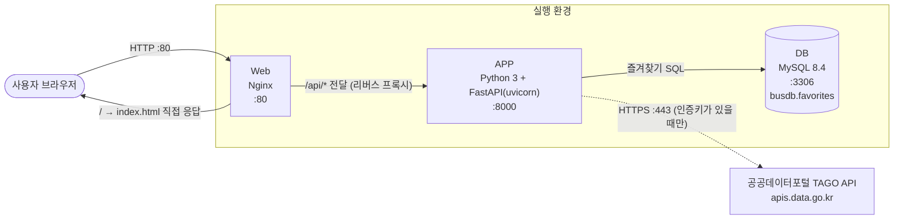

# 1-1 워크로드 분석

버스 도착 정보 앱이 **무엇으로 이루어져 있고, 무엇이 있어야 실행되며, 데이터가 어디에 남고, 밖에서 무엇을 정해 줘야 하는지**를 정리한다.
이 표들이 2~4단계(Docker → Kubernetes → EKS)에서 무엇을 옮기고 무엇을 바꿔야 하는지의 기준이 된다.

## 1. 구성도

| 요청 | 지나가는 길 | 예 |
|---|---|---|
| 화면 | 브라우저 → Web | `GET /` → `index.html` |
| 정류장 검색 · 도착 정보 | 브라우저 → Web → APP → (TAGO API 또는 가짜 데이터) | `GET /api/arrivals/DJB8001793` |
| 즐겨찾기 등록 · 조회 · 수정 · 삭제 | 브라우저 → Web → APP → DB | `PUT /api/favorites/DJB8001793` |

## 2. 실행 조건

| 구성 요소 | 소스 위치 | 언어 · 런타임 | 필요한 것 | 포트 | 시작 명령 |
|---|---|---|---|---|---|
| Web | `app/web/` | 정적 파일(HTML · JS) | Nginx | 80 | `service nginx start` |
| APP | `app/was/` | Python 3.9 이상 | fastapi 0.115.6, uvicorn 0.32.1, PyMySQL 1.1.1 | 8000 | `uvicorn app:app --host 127.0.0.1 --port 8000` |
| DB | `app/db/init.sql` | — | MySQL 8.4 (8.0도 동작) | 3306 | `service mysql start` |

- APP은 컴파일 단계가 없다. "빌드"는 `pip install -r requirements.txt`로 라이브러리를 설치하는 것이다.
- APP은 `127.0.0.1`(같은 컴퓨터 안)에서만 받는다. 외부 접속은 Web(Nginx)만 받는다.

## 3. 데이터가 저장되는 곳

| 데이터 | 저장 위치 | 지워지면 |
|---|---|---|
| 즐겨찾기 (정류장 ID, 이름, 별명, 등록 · 수정 시각) | MySQL `busdb` DB의 `favorites` 테이블 | 사라진다 → **반드시 보존해야 하는 유일한 데이터** |
| 버스 도착 정보 | 저장하지 않음 (요청할 때마다 TAGO API 또는 가짜 데이터) | 영향 없음 |
| 화면 파일 | 이미지(소스)에 포함 | 다시 배포하면 복구 |

- 파일 업로드 같은 별도 저장소가 없다 → APP과 Web은 **상태가 없다(stateless)**. 몇 개로 늘리거나 지웠다 다시 만들어도 된다.
- 상태는 DB 한 곳에만 있다 → 2단계에서는 Docker 볼륨, 3 · 4단계에서는 PersistentVolume으로 DB만 보존하면 된다.

## 4. 외부에서 지정하는 설정 (환경 변수)

| 이름 | 기본값 | 비밀 여부 | 용도 | 3 · 4단계에서 |
|---|---|---|---|---|
| `DB_HOST` | `127.0.0.1` | 아니오 | DB 주소 | ConfigMap |
| `DB_PORT` | `3306` | 아니오 | DB 포트 | ConfigMap |
| `DB_NAME` | `busdb` | 아니오 | DB 이름 | ConfigMap |
| `CITY_CODE` | `25` (대전) | 아니오 | TAGO 도시 코드 | ConfigMap |
| `DB_USER` | `bus` | 예 | DB 계정 | Secret |
| `DB_PASSWORD` | **없음 (필수)** | 예 | DB 비밀번호. 없으면 APP이 시작하지 않는다 | Secret |
| `TAGO_SERVICE_KEY` | 없음 | 예 | 공공데이터 인증키. 없으면 가짜 데이터 | Secret |

Web(Nginx)은 APP 주소를 설정 파일(`app/web/nginx.conf`의 `proxy_pass`)에 갖고 있다. 1단계는 `127.0.0.1:8000`이고, 2단계부터는 컨테이너 · Service 이름으로 바뀐다.

## 5. 외부 의존성

| 대상 | 방향 | 없으면 |
|---|---|---|
| 공공데이터포털 TAGO API (`apis.data.go.kr:443`) | APP → 밖 | 인증키가 없으면 호출하지 않고 가짜 데이터로 동작. 인증키가 있는데 실패하면 502 |

## 6. 다음 단계에 주는 의미

| 분석 결과 | 2단계 (Docker) | 3단계 (Kubernetes) | 4단계 (EKS) |
|---|---|---|---|
| Web · APP은 상태가 없다 | 이미지 2개로 분리 | Deployment로 여러 개 실행 · 자동 복구 | 같음 |
| 상태는 DB에만 있다 | MySQL에 볼륨 연결 | PVC로 보존, DB Pod 교체 후 확인 | EBS StorageClass 직접 생성 |
| 설정은 환경 변수로 받는다 | `docker run -e` | ConfigMap · Secret | 같음 (선택: Secrets Manager) |
| 외부에는 Web만 노출 | Web 포트만 게시 | Web만 NodePort, APP · DB는 클러스터 안 | Web만 ALB |
| APP 주소가 Nginx 설정에 있다 | 컨테이너 이름으로 변경 | Service 이름으로 변경 | 같음 |
