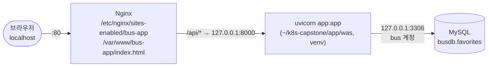

# 1-3 소스 실행 (WSL 2 Ubuntu)

1-2에서 설치한 Nginx · MySQL · Python 가상환경 위에 앱을 올려 실행한다.
순서는 의존 관계를 따른다: **DB 준비 → APP 실행 → Web 연결**. APP은 DB가 있어야 동작하고, Web은 APP이 있어야 `/api/` 요청을 넘길 수 있다.
기능별 확인(등록 · 조회 · 수정 · 데이터 유지)은 1-4 테스트 시나리오에서 한다.

## 1. 실행 구조



| 구성 요소 | 실행 방법 | 위치 · 설정 |
|---|---|---|
| DB | `sudo service mysql start` | DB `busdb`, 계정 `bus`(읽기 · 쓰기 권한만), 테이블 `favorites` |
| APP | `uvicorn app:app --host 127.0.0.1 --port 8000` (터미널 1, 포그라운드) | 환경 변수 `DB_PASSWORD` 필수 |
| Web | `sudo service nginx reload` | 설정 `/etc/nginx/sites-available/bus-app`, 화면 `/var/www/bus-app/index.html` |

## 2. DB 준비

비밀번호는 파일이나 명령 기록에 남기지 않고 터미널 변수로만 입력한다.

```bash
read -s -p "DB 비밀번호: " DB_PASSWORD; echo; export DB_PASSWORD

sudo service mysql start
sudo mysql <<SQL
CREATE DATABASE IF NOT EXISTS busdb DEFAULT CHARACTER SET utf8mb4;
CREATE USER IF NOT EXISTS 'bus'@'localhost' IDENTIFIED BY '${DB_PASSWORD}';
CREATE USER IF NOT EXISTS 'bus'@'127.0.0.1' IDENTIFIED BY '${DB_PASSWORD}';
GRANT SELECT, INSERT, UPDATE, DELETE ON busdb.* TO 'bus'@'localhost';
GRANT SELECT, INSERT, UPDATE, DELETE ON busdb.* TO 'bus'@'127.0.0.1';
SQL
sudo mysql busdb < ~/k8s-capstone/app/db/init.sql

# 확인: 앱 계정으로 접속해 테이블 조회
mysql -h 127.0.0.1 -u bus -p"$DB_PASSWORD" busdb -e "SHOW TABLES;"
```

| 결정 | 이유 |
|---|---|
| 앱 전용 계정 `bus` | root로 접속하지 않는다. 계정이 노출돼도 피해 범위가 이 DB로 한정된다 |
| 권한은 SELECT · INSERT · UPDATE · DELETE만 | 앱은 데이터를 읽고 쓰기만 한다. 테이블 생성 · 삭제(DDL)는 관리자가 `init.sql`로 한다 (확인: `CREATE TABLE`을 시도하면 `ERROR 1142 ... denied`) |
| `localhost`와 `127.0.0.1` 두 계정 | MySQL은 소켓 접속(`localhost`)과 TCP 접속(`127.0.0.1`)을 다른 호스트로 본다. APP은 TCP(`127.0.0.1:3306`)로 접속한다 |
| `utf8mb4` | 정류장 이름 · 별명의 한글을 깨지지 않게 저장한다 |

## 3. APP 실행 (터미널 1)

```bash
cd ~/k8s-capstone/app/was
source .venv/bin/activate
# DB_PASSWORD는 2에서 export한 값을 그대로 쓴다 (새 터미널이면 다시 read -s)
uvicorn app:app --host 127.0.0.1 --port 8000
```

```
INFO:     Started server process [...]
INFO:     Waiting for application startup.
INFO:     Application startup complete.
INFO:     Uvicorn running on http://127.0.0.1:8000 (Press CTRL+C to quit)
```

- `--host 127.0.0.1`: 같은 컴퓨터 안에서만 접속을 받는다. 외부 요청은 Nginx를 거쳐서만 들어온다.
- `DB_PASSWORD`가 없으면 `KeyError: 'DB_PASSWORD'`로 시작하지 않는다(의도된 동작).
- 실제 버스 데이터를 쓰려면 실행 전에 `TAGO_SERVICE_KEY`를 `read -s`로 넣는다. 없으면 가짜 데이터.

## 4. Web 연결

```bash
cd ~/k8s-capstone
sudo cp app/web/nginx.conf /etc/nginx/sites-available/bus-app
sudo ln -sf /etc/nginx/sites-available/bus-app /etc/nginx/sites-enabled/bus-app
sudo rm -f /etc/nginx/sites-enabled/default
sudo mkdir -p /var/www/bus-app
sudo cp app/web/html/index.html /var/www/bus-app/
sudo nginx -t
sudo service nginx reload
```

| 결정 | 이유 |
|---|---|
| `sites-available` + `sites-enabled` 링크 | Ubuntu Nginx의 표준 방식. 설정 파일은 보관하고, 켜고 끄는 것은 링크로 한다 |
| 기본 사이트(`default`) 링크 삭제 | 기본 사이트도 80번을 쓰므로 우리 설정과 겹친다 |
| 화면 파일을 `/var/www/bus-app`에 복사 | Nginx는 `www-data` 사용자로 동작한다. Ubuntu의 홈 디렉터리(`/home/사용자`)는 다른 사용자가 읽을 수 없어, 홈에 둔 파일을 직접 가리키면 403이 난다 |
| `nginx -t` 후 `reload` | 설정 문법을 먼저 검사하고, 끊김 없이 설정만 다시 읽는다 |

## 5. 실행 확인 (터미널 2)

```bash
curl -s http://localhost/api/healthz                 # {"status":"ok","mode":"fake"}
curl -s -o /dev/null -w "%{http_code}\n" http://localhost/      # 200
curl -s "http://localhost/api/stops?name=%EB%B6%81%EB%8C%80%EC%A0%84"   # 북대전 검색
curl -s http://localhost/api/arrivals/DJB8001793     # 버스 목록
```

브라우저에서 `http://localhost` → 폰 모양 화면 → "북대전" 검색 → 정류장 선택 → 도착 정보 표시.

| 상황 | `/` | `/api/healthz` | 의미 |
|---|---|---|---|
| Nginx만 켜짐, APP 꺼짐 | 200 | **502** | Web은 동작하지만 넘길 APP이 없다 (Bad Gateway) |
| 모두 실행 | 200 | 200 | 정상 |

## 6. 종료와 다시 시작

| 하고 싶은 것 | 방법 |
|---|---|
| APP 종료 | 터미널 1에서 `Ctrl + C` |
| 다시 시작 (WSL 재시작 후 포함) | `sudo service mysql start && sudo service nginx start` → 터미널 1에서 3번 다시 |

## 7. 이 단계에서 직접 관리한 것 (2단계와 비교할 기준)

- 서비스 3개(MySQL · APP · Nginx)를 정해진 순서로 따로 켜고 끈다. APP은 터미널 하나를 계속 차지한다.
- 설정 파일과 화면 파일을 시스템 경로(`/etc/nginx`, `/var/www`)에 직접 복사한다. 소스를 고치면 다시 복사해야 한다.
- 비밀번호를 터미널마다 다시 입력해야 한다.

2단계(Docker)에서는 이 순서 · 경로 · 설정이 이미지와 실행 옵션 안으로 들어간다.
