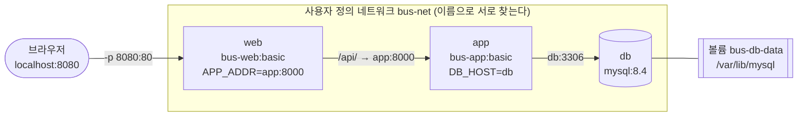

# 2-6 컨테이너 실행 · 테스트 시나리오

> 원래 2-2였다. 2단계를 Docker Core 4 · 5장 순서(2-1 ~ 2-5: Dockerfile 단계적 개선)로 다시 나누면서 2-6으로 옮겼다. 이 문서의 이미지 태그(`basic`)와 설명은 2-6을 진행할 때 2-5 완성 이미지 기준으로 고친다.

2-1에서 만든 이미지(APP · Web)와 MySQL 공식 이미지로 1단계와 같은 구성을 컨테이너로 실행하고, 같은 테스트 시나리오(T1~T9)를 통과시킨다.
기반 자료: Docker Core 2장(컨테이너 실행 · 생명주기 · 로그 · 재시작 정책), 6장(볼륨), 7장(사용자 정의 네트워크 · 포트 게시).

## 1. 구성



| 컨테이너 | 이미지 | 밖으로 연 포트 | 설정 (환경 변수) | 데이터 |
|---|---|---|---|---|
| `db` | `mysql:8.4` (공식) | 없음 | `MYSQL_ROOT_PASSWORD`, `MYSQL_DATABASE=busdb`, `MYSQL_USER=bus`, `MYSQL_PASSWORD` | 볼륨 `bus-db-data` |
| `app` | `bus-app:basic` | 없음 | `DB_USER=bus`, `DB_PASSWORD`, (`TAGO_SERVICE_KEY`) — `DB_HOST=db` 등은 이미지 기본값 | 없음 |
| `web` | `bus-web:basic` | `8080 → 80` | `APP_ADDR=app:8000` (이미지 기본값) | 없음 |

## 2. 1단계 → 2단계

| 1단계 (WSL 직접) | 2단계 (컨테이너) |
|---|---|
| `apt install mysql-server`, `service mysql start` | `docker run mysql:8.4` |
| `CREATE DATABASE` · `CREATE USER` · `GRANT` 를 손으로 실행 | `MYSQL_DATABASE` · `MYSQL_USER` · `MYSQL_PASSWORD` 환경 변수 + `app/db/*.sql` 을 `/docker-entrypoint-initdb.d` 에 연결 (처음 시작 때 자동 실행) |
| 데이터: `/var/lib/mysql` (WSL 디스크) | 데이터: 볼륨 `bus-db-data` |
| 접속 주소 `127.0.0.1` | 컨테이너 이름 `db` · `app` (같은 네트워크의 내장 DNS) |
| APP이 터미널 하나를 차지 | `-d` 백그라운드 실행, `docker logs` 로 로그 |
| 서비스는 WSL 재시작 때 직접 시작 | `--restart unless-stopped` |
| T8 = 프로세스 재시작 | T8 = **컨테이너 삭제 후 새로 실행** (`docker/down.sh` → `docker/up.sh`) |

## 3. 실행

```bash
cd ~/k8s-capstone
read -rsp "DB root 비밀번호: " DB_ROOT_PASSWORD; echo; export DB_ROOT_PASSWORD
read -rsp "DB 비밀번호(bus): " DB_PASSWORD; echo; export DB_PASSWORD
bash docker/up.sh           # 네트워크 · 볼륨 생성 → db (healthy 대기) → app → web
bash tests/scenario.sh http://localhost:8080
#   T7 뒤 멈추면: bash docker/down.sh && bash docker/up.sh  → Enter
bash docker/down.sh         # 컨테이너만 삭제 (볼륨 유지)
```

`docker/up.sh` 는 Runbook에서 하나씩 실행하는 `docker run` 명령을 모은 것이다.

## 4. 설계 선택과 이유

| 선택 | 이유 | 다른 방법을 쓰지 않은 이유 |
|---|---|---|
| 사용자 정의 네트워크 `bus-net` | 같은 네트워크의 컨테이너는 **이름으로** 서로 찾는다(내장 DNS). 이미지 기본값 `DB_HOST=db`, `APP_ADDR=app:8000` 이 그대로 동작한다 | 기본 bridge 네트워크는 이름 해석이 안 된다. `--link` 는 오래된 방식이다. IP 직접 지정은 컨테이너가 바뀌면 깨진다 |
| 밖으로는 Web 8080만 게시 | 입구는 하나(1-1). DB · APP은 네트워크 안에서만 접근 — 3단계 "DB는 클러스터 안에서만"과 같은 구조 | DB 포트를 게시하면 WSL 밖에서도 DB에 접속할 수 있다. 80은 1단계 Nginx가 쓰고 있다 |
| 볼륨 `bus-db-data` (이름 있는 볼륨) | 컨테이너를 지워도 데이터가 남는다(T8). Docker가 관리하므로 경로 · 권한을 신경 쓰지 않는다 | 바인드 마운트(호스트 폴더)는 소유자 · 권한 문제가 생기기 쉽다. 볼륨 없이 실행하면 컨테이너를 지울 때 데이터도 사라진다 |
| `app/db` 를 `/docker-entrypoint-initdb.d` 에 읽기 전용 연결 | 공식 이미지가 **데이터가 비어 있을 때 한 번만** `init.sql`(표) · `grants.sql`(권한)을 실행한다. 1단계와 같은 `init.sql` 을 재사용한다 | DB 이미지를 따로 만들 필요가 없다. 손으로 SQL을 실행하면 재현이 안 된다 |
| `grants.sql` 로 권한을 다시 줄임 | 공식 이미지는 `MYSQL_USER` 에게 `busdb` 전체 권한(ALL)을 준다 → 1-3과 같은 최소 권한(SELECT · INSERT · UPDATE · DELETE)으로 바꾼다 | 그대로 두면 앱 계정이 표를 지울 수 있다 |
| DB 상태 검사 `--health-cmd "mysqladmin ping -h 127.0.0.1"` | MySQL은 첫 시작 때 초기화로 10초 이상 걸린다. `healthy` 가 된 뒤 APP을 실행한다. 비밀번호 없이 확인한다(접속 거부여도 서버가 응답하면 성공) | 고정 `sleep` 은 환경마다 시간이 다르다 |
| 비밀 값은 `read -s` → `docker run -e` | 이미지 · 저장소 · 명령 기록에 남지 않는다 | 이미지에 넣으면 이미지를 받은 누구나 본다. `.env` 파일은 실수로 커밋될 수 있다 |
| `--restart unless-stopped` | Docker 재시작 · 오류 종료 후 자동 실행. 직접 멈춘 것은 다시 켜지 않는다 | `always` 는 직접 멈춘 컨테이너도 Docker 재시작 때 다시 켠다 |
| T8에서 web까지 세 개 모두 다시 만듦 | Nginx는 **시작할 때** `app` 의 IP를 한 번 찾아 기억한다. app만 다시 만들어 IP가 바뀌면 Web이 옛 IP로 보내 502가 난다(확인함) | 3 · 4단계에서는 Service가 고정 주소를 주므로 이 문제가 없다 |

## 5. 확인 방법

| 확인 | 명령 | 기대 결과 |
|---|---|---|
| 상태 | `docker ps` | 세 컨테이너 `Up`, db는 `(healthy)`, web만 `0.0.0.0:8080->80/tcp` |
| DB 초기화 로그 | `docker logs db 2>&1 \| grep -E "running /docker|ready for connections"` | `grants.sql` · `init.sql` 실행, `ready for connections` |
| 앱 계정 권한 | `docker exec db mysql -ubus -p busdb -e "SHOW GRANTS;"` | `SELECT, INSERT, UPDATE, DELETE ON busdb.*` |
| APP 로그 | `docker logs app` | `Uvicorn running on http://0.0.0.0:8000`, 요청마다 한 줄 |
| Web 로그 | `docker logs web` | 템플릿 처리(`envsubst`) 후 접근 기록 |
| 네트워크 | `docker network inspect bus-net` | 세 컨테이너와 각 IP |
| 볼륨 | `docker volume inspect bus-db-data` | `Mountpoint` |
| 시나리오 | `bash tests/scenario.sh http://localhost:8080` | 통과 9 / 9 (T8 = 컨테이너 삭제 후 재실행) |

## 6. 제작 중 검증

Claude 작업 환경은 Docker Hub에 접속할 수 없어 공식 이미지 대신 대체 이미지로 검증했다.
`mysql:8.4` 대체 = Ubuntu MySQL 8.0 + **공식 이미지의 엔트리포인트 스크립트(docker-library/mysql 8.4)** 그대로.

| 확인 | 결과 |
|---|---|
| `docker/up.sh` | DB healthy(약 12초) → app → web, 전체 약 16초 |
| 초기화 | `Creating user bus` → `grants.sql` → `init.sql` 실행. `SHOW GRANTS` = SELECT · INSERT · UPDATE · DELETE |
| 권한 | 앱 계정 `CREATE TABLE` → `ERROR 1142` |
| 재실행 | 볼륨이 있으면 초기화 스크립트를 다시 실행하지 않음 |
| 시나리오 | 9 / 9 (T8: `down.sh` → `up.sh` 후 별명 유지) |
| app만 재생성 | IP가 바뀌면 Web이 502 → web 재시작 후 200 (T8에서 세 개 모두 다시 만드는 이유) |
| `docker stop app` | 0.3초, 종료 코드 0 (exec 형식 CMD로 SIGTERM 정상 처리) |
